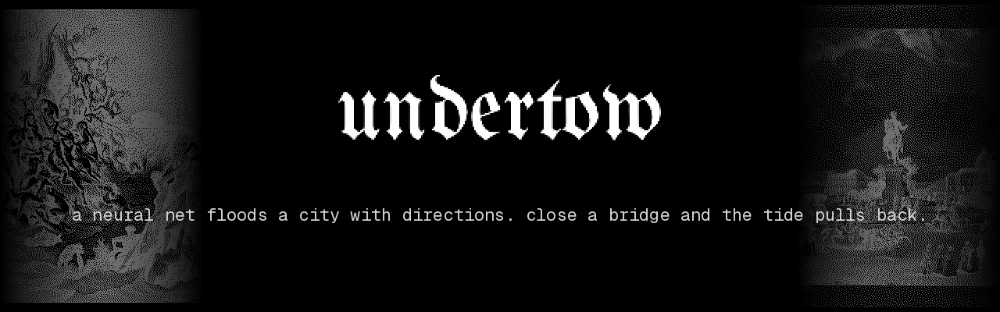
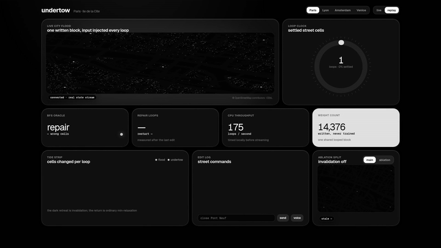
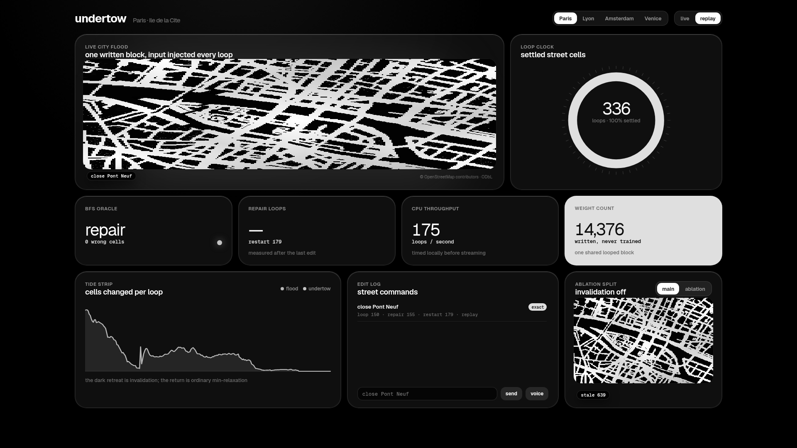
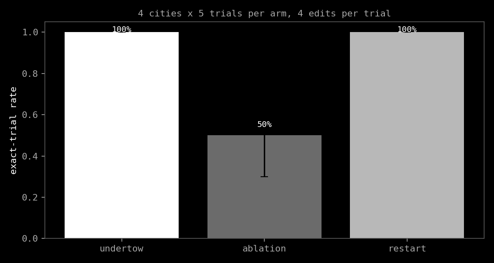
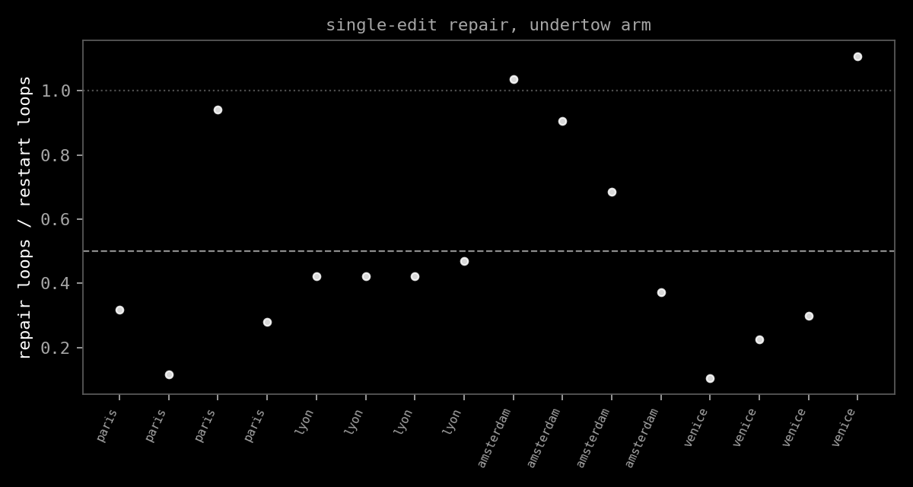

undertow is a written, looped weight-space program that keeps exact shortest-path distances over real OpenStreetMap street grids while streets close and reopen. It is CPU-only, written once rather than gradient-trained, and ships with a live/replay Finance Bento dashboard.

#loops #weights-space #openstreetmap #exactness #cpu-only

  





## The Tide

The visible tide is the easy part. Every loop re-injects the current walkability and transit-exit planes, then applies a synchronous min-relaxation stencil. Distances spread outward through the real raster one cardinal hop at a time.

The maps are not drawn fixtures. Paris, Lyon, Amsterdam, and Venice are cached from real OpenStreetMap data, rasterized at 256x256, capped, checksummed, and attributed under ODbL. The public Overpass endpoints were unreliable during this build, so the committed extracts were fetched through the versioned OpenStreetMap map API fallback and record that provenance in the cache.

## The Undertow

The interesting motion runs backward. When a street closes, cells that depended on it cannot locally know their new distance. The written rule marks them invalid, follows parent pointers upstream one hop per loop, and holds the invalid lane until a cell is locally consistent with a valid parent. Only then does the forward tide refill it.

This is why the state is not restarted. The same tensor is copied in place after every loop. Clicking or speaking `close Pont Neuf` edits the input planes only.

## The Weights

`undertow/weights.py` deterministically writes `weights/undertow_block.npz`; the committed archive has 14,376 matrix-program parameters and regenerates bit for bit. The executable hot loop is the exact integer stencil compiled from that program. It is not a dense literal execution of every attention and MLP matrix multiplication, and `docs/REPORT.md` calls that boundary out explicitly.

The dashboard reports the same number it loads: 14,376 written parameters, never gradient-trained.

## The Results

Scaled committed run: **4 cities x 5 trials per arm x 3 arms = 60 real OSM edit trials**, each with four mid-run named-street edits.

| arm | exact rate | 95% ci | wrong-cell fraction |
|---|---:|---:|---:|
| undertow | 100.0% | 100.0%–100.0% | 0.000% |
| ablation | 50.0% | 30.0%–70.0% | 2.432% |
| restart | 100.0% | 100.0%–100.0% | 0.000% |

| measure | value |
|---|---:|
| median repair loops | 89 |
| median restart loops | 196 |
| median repair/restart | 0.42 |
| cpu throughput | 194 loops/s |
| written weights | 14,376 |





A short gradient-training smoke reached 0/2 exact after a 45 s CPU budget. A real local Qwen2.5-Coder-7B Q4_K_M llama.cpp writer produced an incomplete candidate in one bounded round. Both comparison arms were deliberately small; they are evidence, not full-scale proof. Exact scale and limitations are in `docs/REPORT.md`.

## The Limits

Repair is not magic. Some large central closures cost as much as a restart. Rasterized streets are an approximation. Public Overpass access failed during data collection, so the cache uses the OSM API fallback. The full 200-trial evaluation, 12-hour Arm D training run, and 3x20 writer schedule were not run in this build window.

Negative results ship either way. Numbers in this README are regenerated from `results/core_arms.json`; no result fixture is handwritten.

## Install

```sh
git clone https://github.com/Sebastianrodaaa/undertow.git
cd undertow
python3 -m pip install --index-url https://download.pytorch.org/whl/cpu torch
python3 -m pip install -r requirements.txt
make setup
make test
make play      # live app on http://127.0.0.1:8077
make replay    # replay the committed real event log
```

`make eval` regenerates the scaled core tables. `make train-d` runs the gradient smoke. `make writer-e` downloads the Qwen GGUF if needed, builds/uses local llama.cpp when present, and runs the bounded writer harness. No API key is used.

The setup touches `data/osm/`, `results/`, `weights/`, and optionally `models/` plus `third_party/`. Delete those directories and reinstall nothing else to undo the generated artifacts.

Voice uses strict grammar over known OSM street names. If whisper.cpp and `models/ggml-base.en.bin` are installed, browser microphone audio is decoded locally with ffmpeg and transcribed without a paid API. If they are absent, the dashboard says so and the typed grammar remains.

## The Name

An undertow is the return current under a visible wave. Here the visible wave is distance flooding outward. The undertow is the backward invalidation current that pulls stale descendants out from under it.

## Inspirations

See `INSPIRATIONS.md` for the weight-space program, LoopedWSP, neural algorithmic reasoning, classical incremental search, and Finance Bento references. The closest comparator is LoopedWSP; undertow changes the task by editing real city inputs mid-run and measuring exact state repair.

## License

MIT for this repository. Third-party data, models, fonts, art, and software terms are in `NOTICE.md`. OpenStreetMap data is `(c) OpenStreetMap contributors`, ODbL 1.0.
